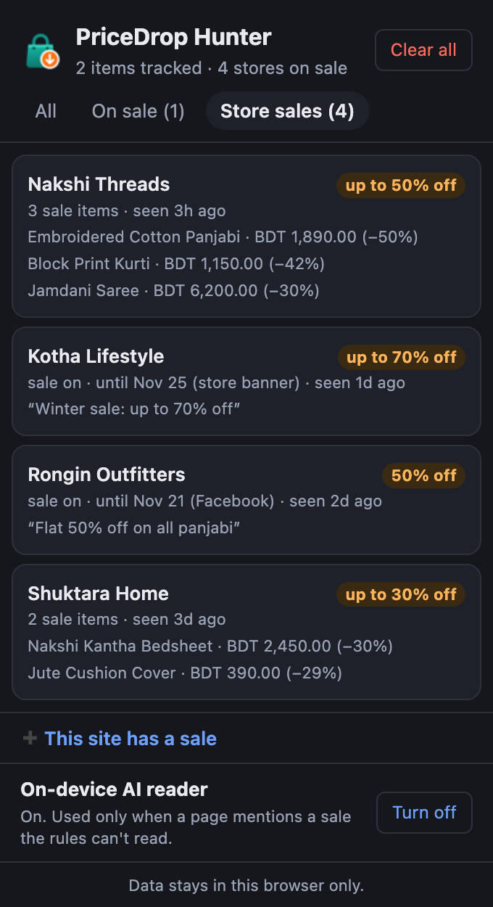

<p align="center">
  
</p>

<h1 align="center">PriceDrop Hunter</h1>

<p align="center">
  A privacy-first Chrome extension that remembers the sales you come across<br>
  and tells you about them when you shop for something similar on another site.
</p>

---

## What it does

Many shops, especially smaller brands in Bangladesh, announce sales only in a
banner image or a Facebook post. You see the sale once, then forget about it a
week later while buying the same thing at full price somewhere else.

PriceDrop Hunter notices those sales while you browse and brings them back
when they're useful:

- **Sale pages.** It reads discounted items (crossed-out prices, "Save ৳ X",
  "30% OFF" labels) from any store and saves them.
- **Banners and announcements.** It picks up store-wide offers such as
  "Flat 50% off till 10th November", in English or Bangla (ছাড়, অফার, সেল).
- **Facebook pages.** It reads sale posts and photos from a brand's Facebook
  page and links them to the brand's own website.
- **Price history.** It tracks product prices over time and shows a badge
  when a product is on sale.
- **Suggestions elsewhere.** When you search or shop on another site (Daraz,
  Amazon, Google and others), it shows matching sales you saw earlier.
- **On-device AI (optional).** When a sale is only in an image, it can ask
  Chrome's built-in model (Gemini Nano) to read it. This is off by default.

There's no store list to set up. It works on any shop automatically.

<p align="center">
  <br>
  <sub>The popup's "Store sales" tab. Demo data: the store names are made up.</sub>
</p>

## Privacy

- Everything is stored in `chrome.storage.local`, in your own browser.
- There's no server, account, analytics or tracking.
- The optional AI runs on your computer through Chrome's
  [Prompt API](https://developer.chrome.com/docs/ai/prompt-api). Page text
  never leaves your device.
- Search engines, social and video sites, and local addresses (`localhost`,
  IP addresses, intranet tools) are never saved as stores.
- "Clear all" in the popup deletes everything.

## Install (developer mode)

1. Clone this repository.
2. Open `chrome://extensions` in Chrome (version 116 or newer).
3. Turn on **Developer mode** in the top-right corner.
4. Click **Load unpacked** and pick the repository folder.

To use the on-device AI reader, turn it on in the popup. Your Chrome must
support the built-in AI (see Chrome's
[built-in AI docs](https://developer.chrome.com/docs/ai/built-in)).

## Development

```bash
npm install      # once: installs jsdom for the tests
npm test         # loads mock store pages in jsdom and runs the real content scripts
npm run package  # builds dist/pricedrop-hunter-<version>.zip for the Chrome Web Store
```

### Project layout

| Path | What it is |
| --- | --- |
| `manifest.json` | Extension manifest (MV3) |
| `shared.js` | Price parsing, sale-text parsing, word matching, storage helpers |
| `content.js` | Runs on store pages: products, sale items, banners, suggestions |
| `facebook.js` | Reads sale posts and photos on Facebook pages |
| `ai.js`, `background.js`, `offscreen.*` | On-device AI fallback |
| `popup.*` | The toolbar popup |
| `tests/` | Test runner and small hand-made mock pages |
| `web/` | Landing page (plain HTML/CSS/JS, no build step) |

### Adding a test

Write a **small mock** of only the markup that matters into `tests/fixtures/`
and add a case in `tests/run.js`. Please don't commit full saved copies of
real store pages. Put those in `tests/fixtures/local/`, which is gitignored.

## Contributing

Issues and pull requests are welcome. If a shop's sales aren't detected, open
an issue with the store's URL and what the sale looks like (a screenshot
helps). Please run `npm test` before opening a pull request.

## License

[MIT](LICENSE)
